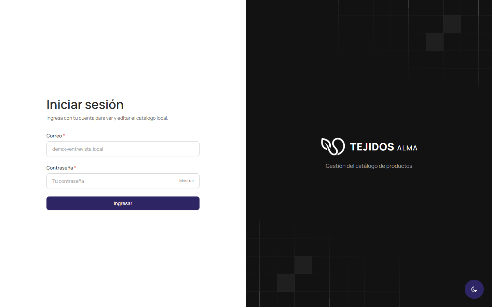
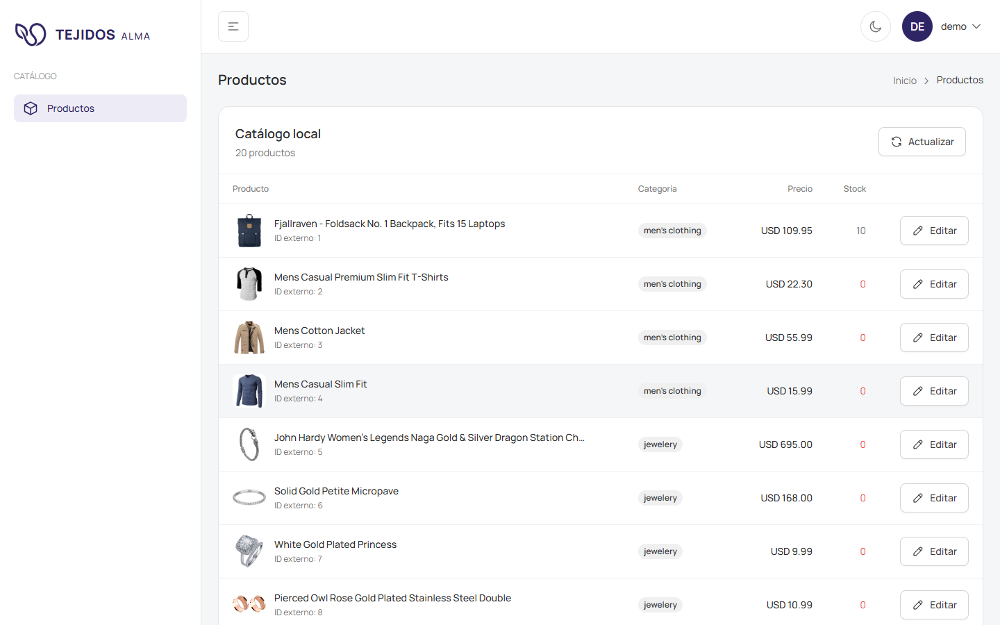
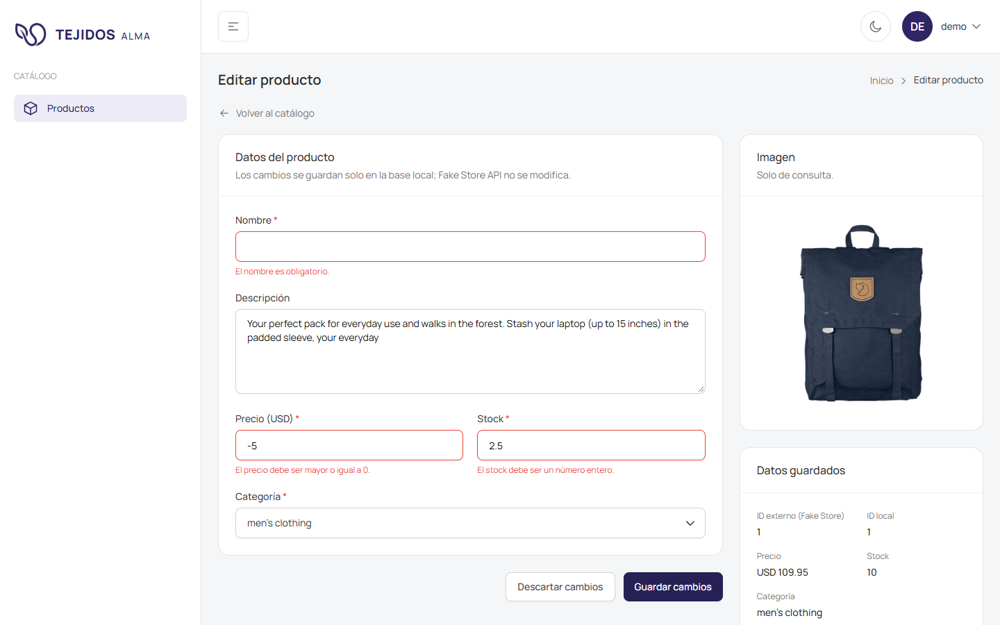
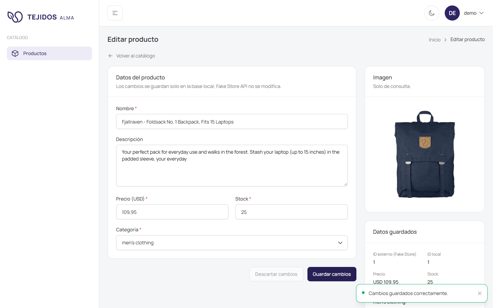

# Tejidos Alma · Catálogo de productos

Aplicación web para iniciar sesión, importar el catálogo de [Fake Store API](https://fakestoreapi.com/docs) y editar los productos guardados en una base de datos local.

| Componente | Tecnología | Carpeta |
|---|---|---|
| Frontend | Angular 22 + TypeScript 6 + Tailwind CSS 4 | `frontend/` |
| Backend | C# .NET 9, API REST con controladores, Entity Framework Core 9 | `Backend/` |
| Base de datos | SQL Server 2022 (Docker en desarrollo) | `Backend/docker-compose.yml` |

El frontend solo habla con el backend. El backend es el único que accede a la base de datos y a Fake Store API.

## Capturas

| Login | Catálogo |
|---|---|
|  |  |

| Edición: errores de validación | Edición: cambios guardados |
|---|---|
|  |  |

## Requisitos

| Herramienta | Versión usada | Para qué |
|---|---|---|
| [.NET SDK](https://dotnet.microsoft.com/download) | 9.0 (probado con 9.0.306) | Backend |
| [Node.js](https://nodejs.org/) | 22.x (probado con 22.23) | Frontend |
| npm | El que trae Node | Dependencias del frontend |
| [Docker Desktop](https://www.docker.com/products/docker-desktop/) | Cualquiera reciente | SQL Server de desarrollo |

No hace falta instalar Angular CLI ni `dotnet-ef` de forma global: el frontend usa el CLI de `node_modules` (`npm start`) y el backend declara `dotnet-ef` como herramienta local (`Backend/.config/dotnet-tools.json`).

## Puesta en marcha (desarrollo)

### 1. Base de datos

```powershell
cd Backend
docker compose up -d
```

Levanta SQL Server 2022 (edición Developer) en `localhost:1433` con el usuario `sa` / `Entrevista#2026` (solo para desarrollo local).

No hay script SQL de inicialización: **al arrancar el backend en dev, las migraciones de EF Core crean la base `EntrevistaDb_Dev` y todas las tablas** (`Database.MigrateAsync()`).

### 2. Backend

```powershell
dotnet run --project Backend/src/Entrevista.Api --launch-profile dev
```

Al arrancar en el perfil `dev`, en este orden:

1. Aplica las migraciones pendientes (crea la base si no existe).
2. Crea el **usuario de demostración** si no existe.
3. **Importa el catálogo** de Fake Store API (categorías y luego productos). Si la API externa falla, la app arranca igual y se puede reintentar (ver [Importación](#importación-del-catálogo)).

Queda escuchando en http://localhost:5054 (solo HTTP en dev). El documento OpenAPI está en http://localhost:5054/openapi/v1.json.

### 3. Frontend

```powershell
cd frontend
npm install
npm start
```

Abre http://localhost:4200. El servidor de desarrollo reenvía `/api/*` al backend (`frontend/proxy.conf.json`), así frontend y API comparten origen y no hace falta CORS.

### 4. Entrar

| Email | Contraseña |
|---|---|
| `demo@entrevista.local` | `Demo#2026` |

## Usuario de demostración

Se crea en el paso 2 del arranque (proceso de inicialización en `Program.cs`), solo si no existe, con las credenciales de la sección `UsuarioDemo` de `appsettings.Development.json`. Para usar otras, cámbialas ahí y reinicia el backend (se crea un usuario nuevo; el anterior no se borra).

La contraseña **nunca se guarda en texto plano**: se hashea con `PasswordHasher` de ASP.NET Core Identity (paquete `Microsoft.Extensions.Identity.Core`), que usa PBKDF2 con HMAC-SHA512, 100.000 iteraciones y una sal aleatoria por usuario guardada dentro del propio hash (`Usuarios.PasswordHash`).

## Importación del catálogo

Es un proceso del backend (`ImportacionCatalogoService`), distinto de las migraciones:

1. `GET https://fakestoreapi.com/products/categories` → guarda las categorías (con su nombre original, en inglés).
2. `GET https://fakestoreapi.com/products` → guarda los productos: `id`→`ExternalId`, `title`→`Nombre`, `description`→`Descripcion`, `price`→`Precio`, `image`→`ImagenUrl`, `Stock = 0`. Cada producto se relaciona con su categoría local por el texto de `category`.

Se puede ejecutar de dos formas:

- **Automática** al arrancar el backend en dev (el resumen queda en el log).
- **Manual**, en cualquier entorno, con `POST /api/catalog/import` (requiere access token, ver [Autenticación](#autenticación)):

```powershell
curl -X POST http://localhost:5054/api/catalog/import -H "Authorization: Bearer eyJ..."
```

Respuestas:

- **200**: resumen por separado para `categorias` y `productos` con `recibidos`, `importados`, `omitidos` y el motivo de cada omitido (ya existía, datos inválidos, repetido, categoría inexistente).
- **502**: Fake Store API no respondió (sin conexión, timeout de 30 s, error HTTP) o devolvió datos inválidos. No se guarda nada; se puede reintentar.
- **409**: otra importación se ejecutó al mismo tiempo. Se puede reintentar.

**Reintentar no duplica ni pisa ediciones**: solo se insertan categorías cuyo `Nombre` no exista y productos cuyo `ExternalId` no exista (índice único). Todo se guarda en un único `SaveChanges`: si algo falla, no queda nada a medias.

## Autenticación

Todos los endpoints requieren access token excepto `login`, `refresh` y `logout`. Sin token, o con uno inválido o vencido, responden **401**. En el frontend, las rutas del catálogo están protegidas por un guard que redirige al login.

Se usan dos tokens:

| | Access token | Refresh token |
|---|---|---|
| Qué es | JWT firmado (HMAC-SHA256) | 64 bytes aleatorios (no es un JWT) |
| Duración | **15 min** (`Jwt:AccessTokenMinutos`) | **7 días** (`Jwt:RefreshTokenDias`) |
| Cómo viaja | Body de la respuesta → el cliente lo envía en `Authorization: Bearer` | Cookie `refresh_token` (`HttpOnly`, `SameSite=Strict`, solo a `/api/auth`) |
| Dónde se guarda en el cliente | **Solo en memoria** (se pierde al recargar) | La gestiona el navegador; JavaScript no puede leerla |
| En el servidor | No se guarda: se valida por firma | Tabla `RefreshTokens`, **solo el hash SHA-256** |

| Endpoint | Qué hace |
|---|---|
| `POST /api/auth/login` | Valida email y contraseña. **200** con `{ accessToken, expiraEn, usuario }` + cookie del refresh token. **401** con el mismo mensaje si el email no existe o la contraseña es incorrecta. **400** si el formato es inválido |
| `POST /api/auth/refresh` | Con la cookie, devuelve un access token nuevo y **rota** el refresh token (el anterior queda revocado). **401** si no hay cookie, venció o fue revocado |
| `POST /api/auth/logout` | **Revoca el refresh token en la base** y borra la cookie. **204** |
| `GET /api/auth/me` | `{ id, email }` del usuario del access token |

```powershell
# -c guarda la cookie del refresh token y -b la envía (como el navegador)
curl -c cookies.txt -X POST http://localhost:5054/api/auth/login `
  -H "Content-Type: application/json" `
  -d '{ "email": "demo@entrevista.local", "password": "Demo#2026" }'

curl http://localhost:5054/api/products -H "Authorization: Bearer eyJ..."
curl -b cookies.txt -c cookies.txt -X POST http://localhost:5054/api/auth/refresh
curl -b cookies.txt -c cookies.txt -X POST http://localhost:5054/api/auth/logout
```

**Detección de reúso**: si llega un refresh token que ya fue rotado, alguien más lo tiene. Se revocan **todos** los refresh tokens del usuario y hay que volver a iniciar sesión.

**En el frontend**:

- Al cargar la página llama a `/refresh`: si la cookie sigue vigente, recupera la sesión sin pedir credenciales.
- Renueva el access token un minuto antes de que venza.
- Si una petición responde 401, llama a `/refresh` y la reintenta una vez (las peticiones simultáneas comparten esa única llamada). Si falla, vuelve al login con el aviso de sesión expirada.

### Cierre de sesión y expiración

- Al cerrar sesión, el frontend llama a `/logout` (revoca el refresh token y borra la cookie), descarta el access token de memoria y vuelve al login.
- ⚠️ **El access token es un JWT sin revocación: el que ya se emitió sigue siendo válido hasta que vence** (como máximo 15 minutos), aunque se haya cerrado sesión. Por eso su duración es corta. El refresh token, en cambio, deja de servir en el momento del logout.
- La tolerancia de reloj del access token está en 0: deja de valer exactamente en `expiraEn`.

## API

| Método | Ruta | Uso | Respuestas |
|---|---|---|---|
| `POST` | `/api/auth/login` | Iniciar sesión | 200, 400, 401 |
| `POST` | `/api/auth/refresh` | Renovar el access token | 200, 401 |
| `POST` | `/api/auth/logout` | Cerrar sesión | 204 |
| `GET` | `/api/auth/me` | Usuario actual | 200, 401 |
| `GET` | `/api/products` | Listar productos locales | 200 |
| `GET` | `/api/products/{id}` | Obtener el producto a editar | 200, 404 |
| `PUT` | `/api/products/{id}` | Guardar cambios locales | 200 (producto actualizado), 400, 404 |
| `GET` | `/api/categories` | Cargar el selector de categorías (ordenadas por nombre) | 200 |
| `POST` | `/api/catalog/import` | Importar el catálogo completo | 200, 409, 502 |

Body del `PUT` (solo campos editables; `ExternalId` e `ImagenUrl` no se modifican):

```json
{ "nombre": "Mochila", "descripcion": "Texto opcional", "precio": 109.95, "stock": 10, "categoriaId": 1 }
```

Validaciones en el backend, con mensajes en español por campo (400): nombre obligatorio (no vale solo con espacios) y de hasta 200 caracteres, descripción de hasta 2000, precio ≥ 0, stock entero ≥ 0, categoría local existente, y valores con formato válido (`"stock": 1.5` o `"precio": "abc"` se rechazan). El frontend aplica las mismas reglas antes de enviar y muestra los errores del backend en cada campo.

Los cambios solo se guardan en la base local; nunca se envían a Fake Store API.

## Modelo de datos

| Tabla | Campos | Restricciones |
|---|---|---|
| `Usuarios` | `Id`, `Email`, `PasswordHash` | `Email` único |
| `RefreshTokens` | `Id`, `UsuarioId`, `TokenHash`, `CreadoEn`, `ExpiraEn`, `RevocadoEn`, `ReemplazadoPorHash` | `TokenHash` único (SHA-256); FK a `Usuarios` (borrado en cascada) |
| `Categorias` | `Id`, `Nombre` | `Nombre` único |
| `Productos` | `Id`, `ExternalId`, `Nombre`, `Descripcion`, `Precio`, `Stock`, `CategoriaId`, `ImagenUrl` | `ExternalId` único; `Precio` decimal(18,2); `Stock` int; FK a `Categorias` (sin borrado en cascada) |

Las migraciones están en `Backend/src/Entrevista.Api/Data/Migrations/` (`InitialCreate`, `AgregarRefreshTokens`).

## Configuración

El backend lee `appsettings.json` (común) y luego `appsettings.{Entorno}.json`, que pisa los valores comunes. Cada perfil de `launchSettings.json` define el entorno:

| Perfil | Entorno | Archivo | ¿En git? |
|---|---|---|---|
| `dev` | `Development` | `appsettings.Development.json` (SQL Server de Docker, credenciales solo de desarrollo) | Sí |
| `prod` | `Production` | `appsettings.Production.json` | **No** (`.gitignore`). Plantilla sin secretos: `appsettings.Production.example.json` |

| Clave | Dev | Por defecto | Qué hace |
|---|---|---|---|
| `ConnectionStrings:DefaultConnection` | Docker local | — | Si falta, la app no arranca |
| `Urls` | `http://localhost:5054` | — | Direcciones donde escucha la app |
| `ForzarHttps` | `false` | `true` | Redirige HTTP a HTTPS |
| `Jwt:Key` | Clave de desarrollo | — | Firma del access token, **mínimo 32 caracteres** |
| `Jwt:Issuer`, `Jwt:Audience` | | `Entrevista.Api`, `Entrevista.Client` | Se validan en cada token |
| `Jwt:AccessTokenMinutos`, `Jwt:RefreshTokenDias` | | 15, 7 | Duración de los tokens |
| `Jwt:RefreshCookie:Nombre` | | `refresh_token` | Nombre de la cookie |
| `Jwt:RefreshCookie:Path` | | `/api/auth` | Solo se envía a refresh y logout |
| `Jwt:RefreshCookie:HttpOnly` | | `true` | JavaScript no puede leerla (protege ante XSS) |
| `Jwt:RefreshCookie:SameSite` | | `Strict` | `Strict`, `Lax` o `None` (protege ante CSRF) |
| `Jwt:RefreshCookie:Secure` | `false` | `true` | Solo por HTTPS; en dev se desactiva porque se usa HTTP |
| `UsuarioDemo:Email`, `UsuarioDemo:Password` | Credenciales demo | — | Usuario creado al arrancar en dev |
| `FakeStore:BaseUrl` | | `https://fakestoreapi.com/` | API externa |

La app no arranca si falta la conexión, si `Jwt:Key` falta o es corta, o si `SameSite=None` sin `Secure=true`.

Para usar HTTPS en dev: `"Urls": "https://localhost:7022;http://localhost:5054"`, `"ForzarHttps": true`, `"Jwt:RefreshCookie:Secure": true` y `dotnet dev-certs https --trust`.

## Producción

1. Copiar la plantilla y completarla (conexión al SQL Server real y una clave JWT propia):

   ```powershell
   Copy-Item Backend/src/Entrevista.Api/appsettings.Production.example.json Backend/src/Entrevista.Api/appsettings.Production.json
   # Clave aleatoria para Jwt:Key
   [Convert]::ToBase64String([Security.Cryptography.RandomNumberGenerator]::GetBytes(48))
   ```

2. Crear las tablas (en producción las migraciones no se aplican solas):

   ```powershell
   cd Backend
   dotnet tool restore
   $env:ASPNETCORE_ENVIRONMENT = "Production"
   dotnet ef database update --project src/Entrevista.Api
   ```

3. Ejecutar con `dotnet run --project Backend/src/Entrevista.Api --launch-profile prod` (o publicar con `dotnet publish` y correr con `ASPNETCORE_ENVIRONMENT=Production`) e importar el catálogo con `POST /api/catalog/import`.

4. Frontend: `npm run build` genera `frontend/dist/frontend/browser`, que debe servirse **en el mismo origen que la API** (por ejemplo, detrás del mismo reverse proxy con `/api` hacia el backend), igual que el proxy de desarrollo.

En producción no se crea el usuario de demostración (ver [Pendiente](#pendiente)). Se recomienda conectar con un usuario de SQL Server con permisos solo sobre su base, no con `sa`.

## Estructura

```
ENTREVISTA/
├── Backend/
│   ├── Entrevista.sln
│   ├── docker-compose.yml               SQL Server para desarrollo
│   ├── .config/dotnet-tools.json        dotnet-ef como herramienta local
│   └── src/Entrevista.Api/
│       ├── Program.cs                   Configuración, DI, pipeline e inicialización en dev
│       ├── appsettings*.json
│       ├── Common/                      Prefijo global /api y respuesta de validación en español
│       ├── Data/                        AppDbContext y migraciones
│       └── Modules/                     Un módulo por funcionalidad:
│           ├── Auth/                    login, refresh, logout, usuarios y refresh tokens
│           ├── Catalog/                 importación desde Fake Store API
│           ├── Categorias/
│           └── Productos/
├── frontend/
│   ├── proxy.conf.json                  /api → http://localhost:5054
│   └── src/app/
│       ├── core/                        Transversal: config, guards, interceptors, models, services, utils
│       ├── features/                    Pantallas: auth/sign-in, products (list, edit, models, services)
│       └── shared/                      UI reutilizable: components, layout, services, icons, pipe
└── docs/
    ├── screenshots/                     Capturas de este README
    └── brand/                           Logo original
```

Cada módulo del backend separa `Controllers/` (HTTP), `Services/` (reglas de negocio), `Entities/` (tablas), `Configurations/` (mapeo de EF Core: índices, longitudes, relaciones) y `DTOs/` (entrada y salida de la API).

## Decisiones técnicas

**Backend**

- **Módulos por funcionalidad** (`Auth`, `Catalog`, `Categorias`, `Productos`) con controlador → servicio → `DbContext`. Sin capa de repositorios: `DbContext` ya es la unidad de trabajo y cada `DbSet` un repositorio; agregar otra capa encima no aportaba para este alcance.
- **DTOs en la API**, nunca las entidades: la respuesta no expone campos internos y el `PUT` solo acepta lo editable.
- **Importación en un único `SaveChanges`**, idempotente por `ExternalId` y `Nombre` únicos. Los errores de la API externa se traducen a una excepción propia (`FakeStoreException`) para responder 502 sin guardar nada.
- **Typed `HttpClient`** (`AddHttpClient<FakeStoreClient>`) con URL base y timeout en configuración.
- **Access token en memoria + refresh token en cookie `HttpOnly`**: el token que da acceso no queda en `localStorage` (expuesto a XSS) y el de larga duración no es legible por JavaScript. La rotación con detección de reúso y la revocación en el logout permiten invalidar sesiones, algo que un JWT solo no permite.
- **Validación con Data Annotations** y una respuesta 400 propia con mensajes en español por campo (`ValidacionResponseFactory`).
- **Configuración por entorno** validada al arrancar: si falta algo crítico, la app no arranca con un mensaje claro.

**Frontend**

- **Angular 22 moderno**: componentes standalone, `OnPush`, sin zone.js (zoneless), signals (`signal`, `computed`, `linkedSignal`, `input()`, `model()`, `output()`), control de flujo `@if`/`@for`.
- **`rxResource`** para cargar datos (listado, producto, categorías): estado de carga, error y recarga sin suscripciones manuales.
- **Signal Forms** (`@angular/forms/signals`) con un esquema de validación igual al del backend. Los controles reutilizables (`app-input-field`, `app-select`, `app-text-area`) implementan `FormValueControl` y se enlazan con `[formField]`.
- **Carpetas por responsabilidad**: `core/` (sesión, interceptor, guards), `features/` (pantallas con sus modelos y servicios) y `shared/` (UI reutilizable).
- **Proxy de desarrollo** para que frontend y API compartan origen: la cookie `SameSite=Strict` funciona y no hace falta CORS.
- **UI basada en TailAdmin** (Tailwind CSS 4), reutilizando componentes y estilos de un proyecto propio anterior, adaptados a signals. Modo claro y oscuro.

## Herramientas utilizadas

- **Asistencia de IA**: [Claude Code](https://claude.com/claude-code) (Anthropic, modelo Claude Opus) como asistente de programación para escribir y revisar código, depurar, generar las capturas y redactar la documentación.
- **Logo**: generado con Google Gemini (`docs/brand/logo-original.jpeg`); el isotipo se recortó y se pasó a PNG transparente con FFmpeg.
- **UI**: plantilla TailAdmin (Angular + Tailwind CSS), a través de un proyecto propio previo.
- **Capturas**: generadas con Puppeteer sobre la app en ejecución.
- Docker Desktop, .NET SDK, Node.js/npm y Fake Store API.

## Pendiente

Todo el alcance obligatorio está implementado. Mejoras posibles:

- **Tests automáticos** (unitarios del backend y del frontend, y de integración de la API). Hoy la verificación es manual.
- **Inicialización en producción**: el usuario de demostración y la importación automática solo corren en dev. En producción el usuario se tendría que crear a mano; convendría un comando o una opción de configuración para hacerlo.
- **Botón de importación en el frontend**: hoy la importación se lanza al arrancar o por API (`POST /api/catalog/import`).
- **Varias pestañas renovando a la vez**: si dos pestañas usan el mismo refresh token en el mismo instante, el backend lo toma como reúso y cierra la sesión. Se resolvería con un pequeño margen de gracia tras la rotación.
- **Limpieza de refresh tokens** vencidos o revocados (tarea periódica).
- **Despliegue con dominios distintos** para frontend y API: requeriría CORS con credenciales y `SameSite=None; Secure`.

## Comandos útiles

```powershell
# Desde Backend/
docker compose up -d                 # Levantar SQL Server
docker compose down                  # Apagar (los datos se conservan en el volumen)
docker compose down -v               # Apagar y BORRAR los datos
dotnet build
dotnet ef migrations add Nombre --project src/Entrevista.Api -o Data/Migrations

# Desde frontend/
npm start                            # Servidor de desarrollo con proxy (http://localhost:4200)
npm run build                        # Build de producción
```
